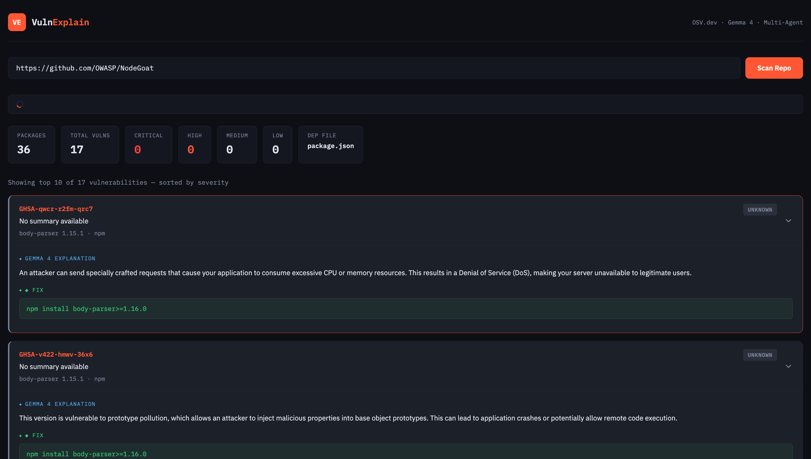

# VulnExplain

> Scan any GitHub repo for vulnerable dependencies. Get plain-English explanations powered by Gemma 4. Know exactly what to fix.

[](https://vulnexplain-btbp.onrender.com)
[](https://python.org)
[](https://ai.google.dev)
[](https://osv.dev)
[](https://sarvam.ai)

**Live demo:** https://vulnexplain-btbp.onrender.com



---

## What is OSV.dev?

[OSV.dev](https://osv.dev) (Open Source Vulnerabilities) is Google's open-source vulnerability database. It aggregates CVEs and security advisories from GitHub, PyPI, npm, and 15+ other ecosystems into one free, unified API. Unlike the NVD (National Vulnerability Database) which is hard to query, OSV.dev is designed specifically for dependency scanning — you send it a package name + version and it tells you every known vulnerability. No API key required.

VulnExplain uses OSV.dev's batch query endpoint to check all dependencies in a repo simultaneously, making scans fast and comprehensive.

---

## The Problem

Every software project depends on open-source packages. Many of those packages have known security vulnerabilities — but developers don't know about them. And even when they find out, CVE reports look like this:

> *"Improper neutralization of special elements used in an OS command"*

Nobody understands that.

## What VulnExplain Does

Give it a GitHub repo URL → it does everything else:

1. **Agent 1 — Fetcher** reads the repo's `requirements.txt` or `package.json` and extracts every package + version
2. **Agent 2 — Scanner** checks all packages against [OSV.dev](https://osv.dev) (Google's open vulnerability database with 50,000+ CVEs)
3. **Agent 3 — Explainer** sends each vulnerability to **Gemma 4** which explains it in plain English and suggests the exact fix command

**Example output for Django 1.8.3:**
```
GHSA-3f2c-jm6v-cr35 [XSS]
This vulnerability allows attackers to inject malicious scripts via the
admin interface, stealing session cookies or sensitive user data.
FIX: pip install Django>=4.2.0
```

## Architecture

```
GitHub Repo URL
      │
      ▼
┌─────────────────┐
│  Agent 1        │  Fetches requirements.txt / package.json
│  Fetcher        │  Parses package names + versions
└────────┬────────┘
         │
         ▼
┌─────────────────┐
│  Agent 2        │  Batch queries OSV.dev API
│  Scanner        │  Returns all known CVEs per package
└────────┬────────┘
         │
         ▼
┌─────────────────┐
│  Agent 3        │  Calls Gemma 4 (gemma-4-26b-a4b-it)
│  Explainer      │  Plain English explanation + exact fix
└────────┬────────┘
         │
         ▼
  Prioritized vulnerability report
  (Critical → High → Medium → Low)
         │
         ▼
┌─────────────────┐
│  Sarvam TTS     │  bulbul:v4-flash (en-IN)
│  Voice Agent    │  Reads explanation aloud on demand
└─────────────────┘
```

## Tech Stack

| Layer | Technology |
|---|---|
| Backend | Python, FastAPI |
| Vulnerability Data | [OSV.dev](https://osv.dev) — Open Source Vulnerabilities database (free, no key needed) |
| AI Explanations | Gemma 4 (`gemma-4-26b-a4b-it`) via Gemini API |
| Voice Narration | Sarvam AI TTS (`bulbul:v4-flash`, `en-IN`) |
| Frontend | Vanilla HTML/CSS/JS |
| Deployment | Render |

## How to Run Locally

```bash
git clone https://github.com/Namithhn025/vulnexplain.git
cd vulnexplain
GEMINI_API_KEY=your_key_here ./start.sh
```

Open http://localhost:8000 and paste any public GitHub repo URL.

**Get a free Gemini API key:** https://aistudio.google.com

## Supported Languages

| File | Ecosystem |
|---|---|
| `requirements.txt` | Python / PyPI |
| `package.json` | Node.js / npm |

## Example Repos to Scan

```
https://github.com/nVisium/django.nV       # Python — 46 vulns
https://github.com/OWASP/NodeGoat          # Node.js — dozens of vulns
```

## Why Gemma 4?

Gemma 4 (`gemma-4-26b-a4b-it`) is Google's open-weight model — meaning anyone can run it locally or in the cloud without vendor lock-in. We use it because:

- **Open source aligned** — an open-weight model explaining open-source vulnerabilities feels right
- **Fast** — the mixture-of-experts architecture (26B active parameters) gives quality responses quickly
- **Accurate for security** — Gemma 4 understands CVE descriptions, attack vectors, and package ecosystems well enough to give actionable, developer-friendly explanations

## How VulnExplain Helps Open Source

Open source powers the world — but dependency vulnerabilities are the #1 attack vector. Most developers never check. VulnExplain makes it trivially easy:

- **No setup** — paste a GitHub URL, get results in under 2 minutes
- **No jargon** — Gemma 4 translates CVE-speak into plain English
- **Actionable** — every finding comes with the exact `pip install` or `npm install` fix command
- **Free** — OSV.dev is free, Gemma API has a free tier, the tool is open source

## Hackathon

Built for **Hacktoberfest Hack Day Bengaluru 2026**

| Track | Criteria | How VulnExplain qualifies |
|---|---|---|
| **Track 1 — G5** | Built with Gemma 4 | Gemma 4 (`gemma-4-26b-a4b-it`) explains every CVE in plain English |
| **Track 2 — O3** | Trustworthy & Verifiable AI | Every explanation links to real OSV.dev CVE data — fully auditable |
| **Track 3 — S6** | Built with Sarvam AI | Sarvam TTS (`bulbul:v4-flash`) voices the vulnerability explanations in English (Indian accent) |

- **Team:** TheCockroaches
- **Event:** 18 October 2026, Startup Park, Bengaluru
